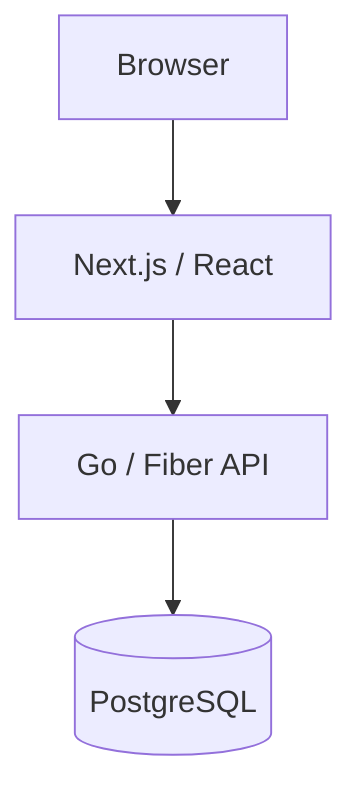

# OpenInvest

Privacy-first investment portfolio accounting and analytics for retail investors; not a broker, bank, trading platform or investment/tax adviser. Financial facts are backend-owned and unavailable market data are not fabricated.

## Capabilities and architecture

- Email-proof account activation without automatic login; separate login/refresh/logout and authenticated portfolio ownership isolation.
- Append-only ledger, correction/reversal, CSV review/explicit append, deterministic STOCK/BOND holdings and WAC/acquisition basis, historical positions, cash/income, explicit RUB manual valuation and backend-owned XIRR.
- User-supplied dividend calculator and provider-neutral Corporate Actions Calendar/Heatmap; event density is not realized ledger income.
- Decimal arithmetic, idempotent response replay, versioned snapshots and explicit authentication/admission/source-use boundaries; [current contracts and limitations](docs/SOURCE_OF_TRUTH.md).
- Ledger operations: `BUY`, `SELL`, `DIVIDEND`, `COUPON`, `FEE`, `TAX`, `DEPOSIT`, `WITHDRAWAL`.



Next.js is presentation only; Go owns the business API and PostgreSQL canonical data.

## Status and limits

Public demo is not deployed. Automated live market pricing is not approved; valuation uses authenticated `USER_SUPPLIED` RUB prices. MOEX adapter remains dormant; constrained T-Invest Corporate Actions is implemented but production traffic is not activated. No brokerage synchronization, orders/trading or implied mobile/inflation/tax/notification activation.
SMTP activation is separately gated; local development does not configure a production sender or deliver verification mail. Source/provider permissions remain in the [Data Source Registry](docs/registries/DATA_SOURCE_REGISTRY.md), with [research evidence](docs/research/CORPORATE_ACTIONS_SOURCE_OUTREACH.md).
[Module #1 technical acceptance/integration](docs/audit/MODULE1_TECHNICAL_CLOSURE.md) and [Module #12 scoped revalidation](docs/audit/FINAL_PRODUCTION_FRONTEND_INFRA_HARDENING_ADVERSARIAL_AUDIT_CLOSURE.md) are repository evidence, not new formal-closure/deployment approval; edge/CDN, quotas, topology, TLS and deployed-network controls remain deployment-specific.

## Run locally

### Requirements

- Go `1.26.9`, matching [backend-go/go.mod](backend-go/go.mod);
- Node.js `>=22.22.2`;
- pnpm `11.8.0` through Corepack;
- Docker / Docker Compose;
- Python `>=3.12` and `uv` only for the full Python verification path.

### Fresh clone

Enable the pinned package manager and install the Web dependencies:

```bash
corepack enable
cd frontend-next
corepack pnpm install --frozen-lockfile
cd ..
```

The default local path uses PostgreSQL `openinvest/openinvest-local` on port `5432` and Redis on
port `6379`. Both `pnpm run bootstrap` and the `dev:api` fallback derive the local PostgreSQL
database identity from `POSTGRES_DB`, `POSTGRES_USER`, `POSTGRES_PASSWORD`, and `POSTGRES_PORT`;
an explicit `DATABASE_URL` still overrides the API fallback. `.env.example` documents optional
overrides and production security boundaries.

Bootstrap infrastructure and the complete current PostgreSQL schema:

```bash
pnpm run bootstrap
```

`bootstrap` validates the repository migration policy, starts PostgreSQL and Redis, discovers every
canonical `infrastructure/postgres/migrations/*.up.sql` migration in deterministic filename order,
and applies the complete set to a fresh database. Re-running it against a database whose schema
already matches the canonical migration set is a safe no-op. A partially initialized or ambiguous
database fails closed; the command never drops or recreates developer data automatically.

Start the API:

```bash
pnpm run dev:api
```

In a second terminal, start the Web application:

```bash
pnpm run dev:web
```

The local Web script points to `http://localhost:8080` by default. The development API script enables a local auth bypass and insecure refresh cookies by default; these are local-only settings, not a production login/deployment configuration. See [.env.example](.env.example) and the [operations guides](docs/operations/) before any separately authorized deployment.

### Verify

```bash
pnpm run verify
pnpm run verify:e2e
```

The E2E smoke path uses the same canonical bootstrap mechanism rather than a historical migration subset.

### Stop local infrastructure

```bash
pnpm run infra:down
```

This stops the normal local containers without deleting the PostgreSQL or Redis volumes.

## Documentation

[Document Index](docs/DOCUMENT_INDEX.md) routes architecture, API, operations and audit evidence. [Source of Truth](docs/SOURCE_OF_TRUTH.md) owns current boundaries; [Roadmap](docs/ROADMAP.md) owns planning; [Implementation Log](docs/IMPLEMENTATION_LOG.md), [stage dossiers](docs/stages/) and [original audit register](docs/audit/REPOSITORY_AUDIT_REMEDIATION_REGISTER.md) retain history. [Documentation standard](docs/governance/DOCUMENTATION_STANDARD.md) and [inventory](docs/governance/DOCUMENTATION_MIGRATION_INVENTORY.csv) distinguish concise explanations from full contracts/evidence; no deployment or campaign is authorized by this README.
